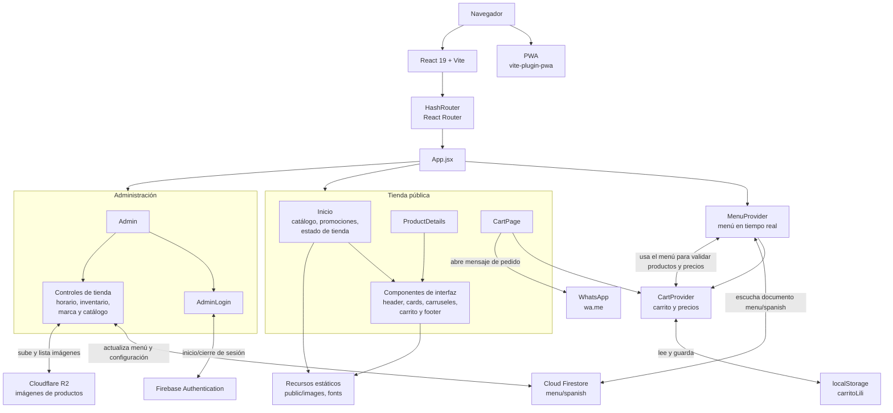
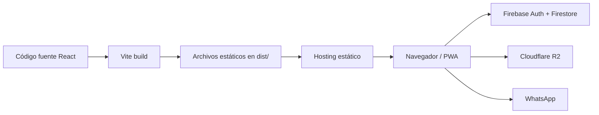

# Arquitectura de Lili Hamburger

## Vista general

La aplicación es una SPA (Single Page Application) construida con React y Vite. Se ejecuta en el navegador y obtiene los datos del menú y la configuración de la tienda desde Firebase Firestore. El panel de administración usa Firebase Authentication y permite guardar cambios en Firestore y gestionar imágenes en Cloudflare R2.

## Flujo de datos y responsabilidades

- **Enrutamiento:** `main.jsx` monta la aplicación con `HashRouter`. `App.jsx` declara las rutas de inicio, carrito, detalle de producto y administración.
- **Menú compartido:** `MenuProvider` inicia con `src/languages/spanish.json` como respaldo y escucha el documento `menu/spanish` de Firestore. Las páginas y controles administrativos consumen ese contexto.
- **Carrito:** `CartProvider` conserva en `localStorage` los identificadores y cantidades. Enriquece esos datos con el menú actual para mostrar información vigente, filtrar productos no disponibles y calcular precios, ofertas y totales.
- **Compra:** `CartPage` construye el pedido y lo entrega a WhatsApp mediante un enlace `wa.me`. El flujo no registra pedidos ni procesa pagos en un backend propio.
- **Administración:** `Admin` observa la sesión de Firebase Authentication. Al iniciar sesión presenta controles para modificar el estado/horario, inventario, encabezado/pie de página y catálogo en Firestore.
- **Imágenes:** los controles administrativos usan `r2Service.js` para cargar y listar imágenes en Cloudflare R2. Las URLs públicas resultantes se guardan como parte de los datos del menú.
- **Idiomas:** `i18n.js` inicializa `react-i18next` con los catálogos español e inglés.
- **PWA y recursos:** Vite genera la aplicación y configura la PWA con actualización automática. Las imágenes y fuentes locales viven en `public/`.

## Construcción y publicación

Vite está configurado con `base: '/'`, compatible con publicación en la raíz de un hosting estático. El proyecto incluye el script opcional `npm run deploy` con `gh-pages`; la configuración actual de Vite documenta Cloudflare Pages como destino.
